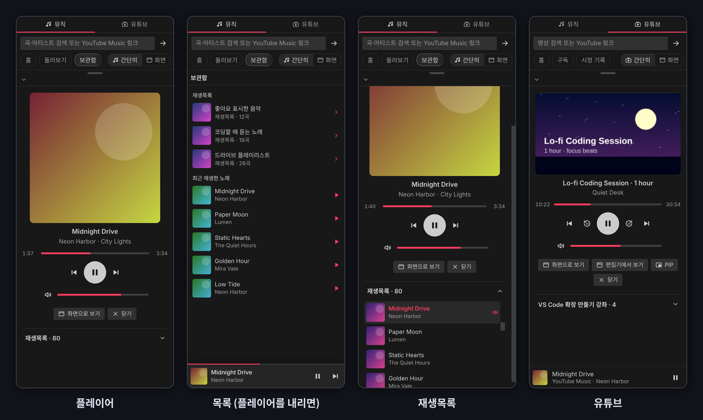
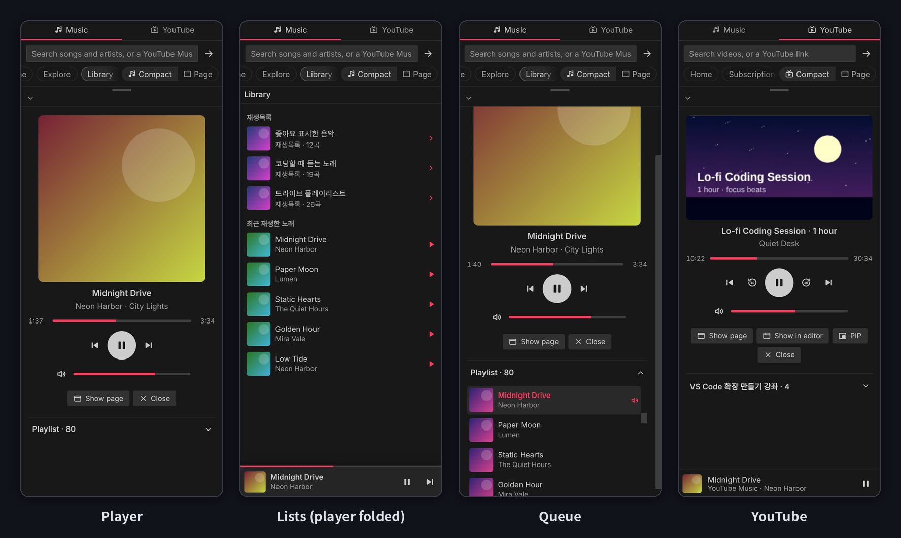

# YouTube Music Player for VS Code

VS Code 사이드바에서 **YouTube Music**과 **YouTube**를 듣고 보는 비공식 확장이에요. API 키도, 따로 할 설정도 없어요.

## 기능

- **간단한 플레이어**: 앨범 아트(유튜브는 영상), 재생 위치, 이전·재생·다음, 볼륨을 보여 줘요. 플레이어를 아래로 내리면 보던 목록이 그대로 있어요.
- **목록으로 둘러보기**: 홈, 보관함, 구독, 시청 기록, 검색 결과를 간단한 목록으로 보여 줘요. 내리는 만큼 계속 불러오고, 목록을 보는 동안에도 재생은 끊기지 않아요.
- **재생목록**: 지금 곡부터 앞뒤 곡을 모두 보여 주고, 끝에서는 다음 곡을 더 불러와요.
- **유튜브는 크게도**: 편집기 탭에서 크게 보고, 새 창으로 분리하거나 항상 위 작은 화면(PIP)으로 볼 수 있어요.
- **사이트 그대로**: `화면`으로 바꾸면 YouTube 화면을 그대로 써요. 클릭, 스크롤, 한글 입력 모두 돼요.
- **상태 표시줄 플레이어**: 이전 · 재생/일시정지와 제목 · 다음 · 음소거. 명령 팔레트와 단축키로도 조작해요.
- **로그인 한 번**: 보관함, 내 재생목록, 구독까지 보여 주고, 다음부터는 로그인된 채로 열려요.
- **가볍게**: 소리는 브라우저가 바로 내고, 화면은 보일 때만 보내요. 소리는 한 번에 하나만 나요.
- **화면 언어**: 한국어 · English · 日本語

## 시작하기

1. 액티비티 바의 아이콘을 눌러 사이드바를 열어요.
2. `YouTube Music 열기` 또는 `YouTube 열기`를 눌러요.
3. (선택) 오른쪽 위 사람 아이콘으로 Google 계정에 로그인해요.

**필요한 것**: Chrome, Edge, Whale, Brave, Vivaldi 중 하나. 기본 브라우저가 이 중 하나면 그걸 쓰고, 아니면 Chrome이나 Edge를 찾아요(Windows에는 Edge가 기본으로 있어요). 이 브라우저가 화면 밖에서 YouTube를 재생해서, 따로 뜨는 창은 없어요. 평소 쓰는 브라우저 프로필은 건드리지 않아요.

## 설정

| 설정 | 기본값 | 설명 |
| --- | --- | --- |
| `vscodeYoutube.player.display` | `vscode` | `vscode`: VS Code 안에서 재생 · `window`: 작은 별도 창 |
| `vscodeYoutube.browser.path` | 자동 | 플레이어로 쓸 브라우저 실행 파일 |
| `vscodeYoutube.statusBar.enabled` | `true` | 상태 표시줄 플레이어 |
| `vscodeYoutube.language` | 자동 | 화면 언어 (`ko`, `en`, `ja`). 비워 두면 VS Code 언어를 따라요 |
| `vscodeYoutube.video.fitToWindow` | `true` | 영상 페이지에서 영상만 꽉 차게 |
| `vscodeYoutube.window.closeWithVSCode` | `true` | VS Code를 닫으면 플레이어 브라우저도 닫기 |

## 명령

명령 팔레트에서 `YouTube Music Player:`로 찾을 수 있어요. 열기, 링크나 검색어로 열기, 재생/일시정지, 다음, 이전, 음소거, 볼륨 올리기·내리기·고르기, 계정, 화면 언어, PIP, 진단 정보 복사가 있어요. 단축키를 지정해 쓸 수도 있어요.

## 개인정보

- 모든 동작이 내 컴퓨터 안에서 일어나요. 외부 서버나 API를 쓰지 않고, 아무 데이터도 보내지 않아요.
- 로그인 정보는 이 확장 전용 브라우저 프로필에만 저장돼요. 로그아웃하면 그 쿠키만 지워요.
- 광고 차단, 다운로드, 재생 제한 우회 같은 기능은 없어요. 브라우저에서 YouTube를 보는 것과 같아요.

## 문제가 생기면

명령 팔레트에서 `YouTube Music Player: 진단 정보 복사`를 실행하면 상태와 최근 로그가 클립보드에 복사돼요(사용자 이름과 이메일은 가려져요). 어떤 상황이었는지와 함께 [GitHub 이슈](https://github.com/21HoKim/youtube-music-player-vscode/issues)에 남겨 주세요.

> YouTube와 YouTube Music은 Google LLC의 상표예요. 이 확장은 Google·YouTube와 관련이 없는 개인 프로젝트예요.

## English

An unofficial extension: listen to **YouTube Music** and watch **YouTube** in the VS Code sidebar. No API keys, no setup.

- **Compact player**: artwork (or the video), progress, previous / play / next, volume. Fold it down to get back to the list you were browsing.
- **Browse as lists**: home, library, subscriptions, history and search results, loading more as you scroll. Playback never stops while you browse.
- **Queue**: the whole queue around the current song; more loads at its end.
- **Bigger YouTube**: an editor tab, its own window, or picture-in-picture.
- **The real site**: switch to `Page` to use YouTube itself (clicks, scrolling, typing).
- **Status bar player** and commands (`YouTube:` in the Command Palette), bindable to keys.
- **Sign in once** for your library, playlists and subscriptions.
- **Light**: the browser plays the sound itself; the picture is sent only while it is visible.
- UI in English, 한국어, 日本語.

Needs Chrome, Edge, Whale, Brave or Vivaldi: it plays YouTube off-screen (no extra window, your own browser profile untouched). Everything stays on your computer. YouTube and YouTube Music are trademarks of Google LLC; this is an independent project, not affiliated with Google.

Something wrong? Run `YouTube Music Player: Copy Diagnostics` from the Command Palette (status and recent logs, user names and emails masked) and open a [GitHub issue](https://github.com/21HoKim/youtube-music-player-vscode/issues) with it and what happened.
